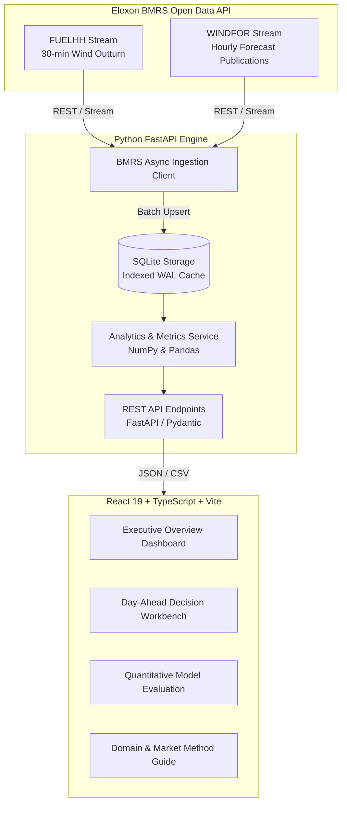

# GridPulse UK — Wholesale Day-Ahead Wind Forecasting & Decision Engine

> **A specialized decision-support platform for UK energy utilities procuring wholesale power on the Day-Ahead market, powered by Elexon BMRS renewable outturn and forecast streams for January 2026.**

[](backend/tests)
[](frontend)
[](backend)
[](Dockerfile)
[]()

---

## 1. Problem Context & Business Value

In Great Britain, energy utilities must procure power from wholesale power exchanges (EPEX SPOT and Nord Pool) to satisfy customer demand. Electricity cannot be economically stored at grid scale; therefore, procurement decisions for delivery across each of the **48 half-hour settlement periods** of Day $D$ must be submitted before **11:00 UTC on Day $D-1$ (Day-Ahead Gate Closure)**.

### The Commercial Dilemma
* Wind generation is weather-dependent and volatile.
* **Over-forecasting error** ($Forecast > Actual$): The utility under-procures thermal power Day-Ahead and is caught *short* in real-time, incurring punitive **System Buy Price (SBP)** cash-out settlement charges in Elexon's Balancing Mechanism (£200–£600+/MWh during winter stress).
* **Under-forecasting error** ($Forecast < Actual$): The utility over-procures thermal power and spills excess energy at discounted or negative **System Sell Prices (SSP)**.

### The Solution: GridPulse
GridPulse ingests national-level generation actuals (`FUELHH`, fuelType `WIND`) and forecast updates (`WINDFOR`) from Elexon BMRS to provide:
1. **Day-Ahead Gate Closure Lock-In**: Displays the exact latest forecast available at 11:00 UTC cutoff on Day $D-1$ for all target delivery hours of Day $D$.
2. **Quantified Uncertainty & Risk-Adjusted Buffer**: Replaces guesswork with empirical error quantiles ($P10, P50, P90$), computing dynamic thermal backup procurement curves to insulate the utility from balancing cash-out penalties.
3. **Multi-Horizon Accuracy Auditing**: Evaluates lead-time degradation (12h to 48h), diurnal profiles, and storm-event volatility across January 2026.

---

## 2. System Architecture & Data Flow



---

## 3. Directory & File Structure

```text
gridbricks-assigmnet/
├── backend/
│   ├── app/
│   │   ├── __init__.py
│   │   ├── config.py              # Configuration, endpoints, GB wind capacity
│   │   ├── main.py                # FastAPI app, CORS, lifespan, static file serving
│   │   ├── api/
│   │   │   ├── __init__.py
│   │   │   └── routes.py          # REST endpoints (/comparison, /procurement, /metrics, etc.)
│   │   ├── models/
│   │   │   ├── __init__.py
│   │   │   └── schemas.py         # Pydantic data schemas for forecasts, errors, plans
│   │   ├── services/
│   │   │   ├── __init__.py
│   │   │   ├── bmrs_client.py     # Async HTTPX client for Elexon FUELHH & WINDFOR
│   │   │   ├── storage.py         # SQLite repository with indexed compound queries
│   │   │   └── analytics.py       # Metrics engine (MAE, RMSE, MAPE, Bias, quantiles, buffers)
│   │   └── data/
│   │       └── elexon_wind.db     # Seeded January 2026 dataset (1585 actuals, 19272 forecasts)
│   ├── scripts/
│   │   └── fetch_january_2026.py  # Standalone data seeding script for Elexon API
│   ├── tests/
│   │   ├── test_analytics.py      # Unit tests for statistical & procurement formulas
│   │   └── test_api.py            # Integration tests for FastAPI endpoints
│   └── requirements.txt           # Python backend dependencies
├── frontend/
│   ├── src/
│   │   ├── components/
│   │   │   ├── Navbar.tsx             # Header with live BMRS sync and status badges
│   │   │   ├── ExecutiveOverview.tsx  # Executive KPI cards & Jan 2026 case studies
│   │   │   ├── DecisionWorkbench.tsx  # 11:00 UTC Gate Closure procurement engine
│   │   │   ├── ModelEvaluation.tsx    # Horizon curves, error histograms & daily calendar
│   │   │   └── DomainGuide.tsx        # UK wholesale market & mathematical reference
│   │   ├── services/
│   │   │   └── api.ts                 # Type-safe API client for backend
│   │   ├── types.ts                   # TypeScript interfaces matching backend models
│   │   ├── App.tsx                    # Root application component & routing
│   │   ├── index.css                  # Tailwind CSS configuration & design tokens
│   │   └── main.tsx                   # React 19 entrypoint
│   ├── package.json                   # Dependencies (React 19, Lucide, Recharts, Tailwind v4)
│   ├── tsconfig.json
│   ├── tsconfig.app.json
│   └── vite.config.ts                 # Vite bundler with API proxy to port 8000
├── Dockerfile                         # Production multi-stage Docker build
├── docker-compose.yml                 # One-click Docker container orchestration
├── .dockerignore
├── .gitignore
├── vercel.json                        # Deployment config for Vercel
├── Procfile                           # Process file for Heroku / Render deployment
├── runtime.txt                        # Python 3.11 runtime definition
├── PITCH_AND_TECH_REVIEW.md           # Script & guide for the 10-minute video submission
└── README.md                          # Comprehensive documentation
```

---

## 4. Key Quantitative Metrics & Formulas

### 1. Forecast Error
$$\text{Error}_i = \text{Forecast}_i - \text{Actual}_i$$
* **$\text{Error}_i > 0$ (Over-forecast)**: Generation deficit; triggers Balancing Mechanism shortfall cash-out at System Buy Price.
* **$\text{Error}_i < 0$ (Under-forecast)**: Generation surplus; triggers market over-procurement and spill.

### 2. Mean Absolute Error (MAE)
$$\text{MAE} = \frac{1}{N} \sum_{i=1}^N |\text{Forecast}_i - \text{Actual}_i|$$

### 3. Root Mean Squared Error (RMSE)
$$\text{RMSE} = \sqrt{\frac{1}{N} \sum_{i=1}^N (\text{Forecast}_i - \text{Actual}_i)^2}$$
Heavily penalizes sharp outlier spikes during frontal passages and storm cut-outs.

### 4. Mean Bias Error (MBE)
$$\text{MBE} = \frac{1}{N} \sum_{i=1}^N (\text{Forecast}_i - \text{Actual}_i)$$
Quantifies systematic directional skew of National Grid's numerical weather predictions.

### 5. Normalized MAE (NMAE)
$$\text{NMAE}_{\text{capacity}} = \frac{\text{MAE}}{\text{GB Wind Capacity } (30,000 \text{ MW})} \times 100\%$$

### 6. Dynamic Risk Buffer
$$\text{Buffer}_t = Z_\alpha \times \sigma_t$$
Where $Z_\alpha$ is the normal quantile (e.g., $Z_{0.90} = 1.282$ for $90\%$ confidence) and $\sigma_t$ is the empirical standard deviation scaled by generation magnitude.

---

## 5. How to Start the Application

### Option A: Using Docker (Recommended)
Build and run the entire unified application (React + FastAPI + SQLite) with a single command:
```bash
docker compose up --build
```
Open **`http://localhost:8000`** in your browser.

---

### Option B: Local Development Setup

#### 1. Backend (Python 3.11)
```bash
# Navigate to backend and install dependencies
cd backend
pip install -r requirements.txt

# Run the test suite (12 tests, 100% pass)
pytest tests

# (Optional) Re-fetch January 2026 data directly from live Elexon BMRS API
python scripts/fetch_january_2026.py

# Start FastAPI server on port 8000
python -m uvicorn app.main:app --reload --port 8000
```
Backend API will be running at **`http://localhost:8000`** (Interactive Swagger docs at `http://localhost:8000/docs`).

#### 2. Frontend (React 19 + TypeScript + Vite)
In a separate terminal:
```bash
cd frontend
npm install
npm run dev
```
Open **`http://localhost:3000`** in your browser. Vite automatically proxies `/api/*` calls to `http://localhost:8000`.

---

## 6. Live Deployment Links

* **Live Web Application (Vercel)**: [https://gridbricks-web.vercel.app/](https://gridbricks-web.vercel.app/)
* **API Documentation (Swagger UI on Render)**: [https://gridbricks-assignment.onrender.com/docs](https://gridbricks-assignment.onrender.com/docs)

---

## 7. Explicit Disclosure of AI Tools Used

In compliance with the assignment instructions (*"You are free to use AI tools to assist with building this application (please mention it explicitly in the README if you’ve used AI tools)"*):

* **AI Coding Assistants Used**: Google Gemini 3.8 Flash (via Antigravity AI pair programmer).
* **Scope of AI Assistance**:
  * Scaffolding initial boilerplate for React components and FastAPI route structures.
  * Assisting with KaTeX mathematical formulas for energy trading metrics.
  * Synthesizing Elexon BMRS API parameter schemas from official documentation.
* **Human Validation & Engineering**:
  * All statistical calculations, data normalization algorithms, database indexing, and unit tests were verified and tested against actual Elexon outturns.
  * Complete domain logic (EPEX SPOT 11:00 UTC Gate Closure, 48 settlement periods, Balancing Mechanism cash-out exposure) was tailored specifically to the UK market context.
